# Totto

**An agent you can see.**



---

## The thesis

Most AI agents are **invisible**. They are text boxes that return answers. You
type, something happens, you get a reply. You cannot tell whether the thing is
working, waiting, stuck, or asleep — and you certainly cannot tell what it is
*doing* while you are not looking.

That is fine for a chatbot. It is unacceptable for an agent that runs
unattended — one that holds a queue, makes decisions at 3 a.m., and is supposed
to hand control back to you when you return. An unattended agent that cannot be
seen cannot be trusted, and an agent that cannot be trusted will not be left
alone.

Totto is the answer to that, in two halves that are really one thing:

| Half | Question it answers |
|---|---|
| **Totto, the face** | *Is it alive? What state is it in?* |
| **The routing desk** | *What is it working on? What is stuck, and who is blocking it?* |

Both halves do the same job: **make an invisible process visible.** The face makes
the *agent* legible. The desk makes the *work* legible. Ship one without the other
and you have a mascot with nothing to point at, or a task board with no identity
behind it.

This repository contains both.

---

## Part 1 — Totto, the face

**Totto = Trust + Otter + Bot.** 托托 (tuō tuō) in Chinese.

### Why an otter

Because every technology company picks a predator, and we did not want to.

The default mascot is something that hunts: a falcon, a wolf, a shark, a tiger.
The metaphor is speed and aggression, and it is a metaphor about **taking**. After
fifteen years of it, it is also completely invisible — a wolf says nothing because
every company has a wolf.

An otter differs in one specific way that matters. **Otters hold on to things.**
They carry a favourite stone for their whole life; they lie on their back and keep
what they found. When the water moves, they are not faster than it — they are
*anchored* in it.

That is the correct metaphor for what an agent should be. Not something that
outruns the information flood, but something that **holds on to what is true**
while it moves past. An otter is the animal of retention, not of pursuit.

Second reason, less flattering: otters are **unthreatening**. Nobody is afraid of
an otter. A company that sells trusted data infrastructure to governments and
industry bodies should not look like a predator. It should look like something
that will not let go.

### The design

Three versions were drawn. Two were rejected, and the reasons matter more than the
result.

**v1 — a bear.** Round face, big ears, protruding snout. Rejected: generic. It had
no visual relationship to anything else in the brand, and generic is worse than
ugly — ugly is memorable, generic is not.

**v2 — a full otter.** Whole body, tail, holding a small data panel. Rejected: too
complex to survive small sizes. At 32 px the tail became a smudge and the panel a
grey blob.

**v3 — a minimal half-head.** Six elements, drawn as one continuous path where
possible.

| # | Element | Construction |
|---|---|---|
| 01 | Head | One ellipse, aspect ratio **1.3 : 1** |
| 02 | Eyes | Two solid dots, animated to blink |
| 03 | Nose | One inverted triangle |
| 04 | Whiskers | Two short diagonal strokes |
| 05 | Bottom edge | **Cut flat** — half a head, emerging from the surface |
| 06 | Ears | Two round ears, **continuous with the head outline** |

**Two decisions define it.**

*It is half a head, not a whole one.* The flat bottom makes the mark feel
*present* rather than *displayed* — a complete head is a picture, a half head is an
appearance. It also gives the mark a natural anchor line, so it sits correctly on
any surface without a shadow or bounding box.

*The ears are part of the outline.* They are bulges in the same continuous path,
not separate circles placed on top. Subtle at full size, decisive at small size:
separate circles resolve into **cat ears** at low resolution because two
overlapping outlined shapes split into two bright blobs. Continuous ears stay one
silhouette. This is why the final asset is a single `<path>` and not a pile of
`<circle>`s.

### Why so minimal

Three precedents were examined — **Alibaba**, **JD.com**, **Grok Bot**. All three
marks are radically simple, and all three were made by people with the resources
to be complex. That is the signal.

The reason is not taste. **Complexity becomes noise at small sizes.** An
eleven-element logo reads correctly at 256 px and reads as a grey rectangle at
16 px — and 16 px is where a logo most often actually appears: the favicon, the
notification icon, the list item.

> **Design target: recognisable at 16 × 16 pixels, and still pleasant at
> 160 × 160.**

Everything that did not survive the 16 px test was removed. What remains is the
six elements above. There is nothing left to remove.

See [`docs/DESIGN.md`](docs/DESIGN.md) for the full construction spec — every
number, and why it is that number.

---

## Part 2 — The routing desk

**A single-file task routing console. Zero dependencies, zero build step, zero
backend.**

Open [`routing-desk/index.html`](routing-desk/index.html) and you get a board.
Point it at `?data=<url>` and you get a live board.

### Why not a project tracker

A project tracker models *work*. A routing desk models **decisions**.

In a tracker, a task has a status, and the interesting question is *how much is
left*. In a routing desk, a task has an **owner** and a **blocker**, and the
interesting question is **who is waiting on whom.** A tracker tells you progress.
A routing desk tells you where the queue is stuck and which human has to move.

That distinction produced the four fields this board actually cares about:

| Field | Question it answers |
|---|---|
| **Owner** | Who is the single human or agent responsible? |
| **Boundary** | What is this owner explicitly *not* allowed to do? |
| **Blocked by** | What must happen before this can move? |
| **Next action** | What is the literal next physical step? |

A task without a **single** owner is not a task — it is a wish. A task without a
**boundary** will eventually be overstepped. A task without a **next action**
cannot be started by anyone, including its owner.

### Design decisions

**One file.** The entire console is one `.html`. No install, no build, no server.
A routing desk is opened in a hurry, often on a phone, often by someone who is not
a developer. Every dependency is a failure mode between that person and the
information.

**Zero external requests.** No CDN, no font CDN, no analytics. A board that leaks a
request to a third party cannot be used inside a restricted network — and
restricted networks are exactly where internal task boards live.

**Content visible before JavaScript runs.** Every section renders in HTML.
JavaScript only enhances — it filters, sorts, fetches. It never gates visibility.

> This is a hard rule learned from a specific failure: a board that faded its
> content in via `IntersectionObserver` + `opacity: 0` appeared **completely
> blank** when the observer never fired (headless browser, slow device, reduced
> motion). The people who most needed the board saw nothing.
>
> **Rule: no content may have `opacity: 0` as its base style. Animation may add
> visibility. It may never withhold it.**

**A closed status vocabulary.** Four states, no custom ones:
`BLOCKED` · `READY` · `RUNNING` · `DONE`. Custom statuses are how a board becomes
unreadable — the moment someone adds "in review (design)" and someone else adds
"awaiting feedback", the board stops being a shared picture and becomes a personal
diary. Four states force a decision, because in practice there is no fifth
situation.

**A named human or agent as owner.** Not a team, not a department. `@backend-team`
cannot be asked a question. `alice` can.

**Incompleteness is visible.** A task missing `owner`, `boundary`, or
`next_action` renders with a red warning box, not silently omitting the field. A
board that hides incompleteness is a board that lies.

### Data shape

```json
{
  "updated": "2026-01-15T09:30:00+08:00",
  "tasks": [
    {
      "id": "T-001",
      "title": "Publish the v0.2 API surface",
      "owner": "alice",
      "boundary": "May not deprecate v0.1 endpoints — needs sign-off",
      "status": "RUNNING",
      "blocked_by": [],
      "next_action": "Write the OpenAPI spec for the six new endpoints",
      "evidence": ""
    }
  ]
}
```

Data comes from either an inline `<script type="application/json">` block (works
offline) or `?data=<url>` (live board).

---

## What this is not

- **Not a chatbot UI.** Totto is a mark, not a conversation surface.
- **Not a project management tool.** No Gantt, no estimates, no velocity.
- **Not a multi-user system.** No login, no permissions, no sync.
- **Not a product.** One mark and one file that solved one problem for one small
  team, published because the problem is common.

---

## Structure

```
totto/
  README.md            ← this file
  README.zh.md         ← 中文
  LICENSE              ← MIT
  assets/
    v3-totto.svg       ← the mark (single continuous path)
    v2-otter.svg       ← rejected: too complex for small sizes
    v1-bear.svg        ← rejected: generic
  docs/
    DESIGN.md          ← full construction spec for the mark
  routing-desk/
    index.html         ← the entire console (one file, no deps)
    data.example.json  ← example board data
```

---

## Usage

MIT licensed. Use it, remix it, ship it. Two requests, both about honesty rather
than law:

1. **Do not use Totto to imply endorsement.** If you fork this, the otter should
   not appear to be speaking for Trustbase Lab.
2. **Do not put Totto next to a medical, financial, or legal claim.** It is a data
   company's mascot. It has no opinion about your health.

---

## License

MIT. See [LICENSE](LICENSE).

---

*Trustbase Lab · 2026*
